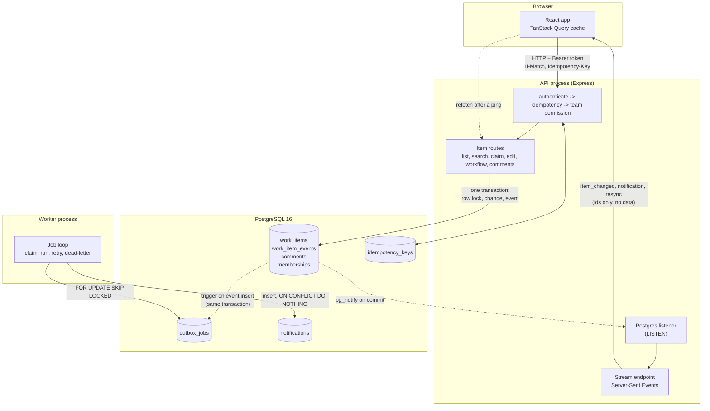
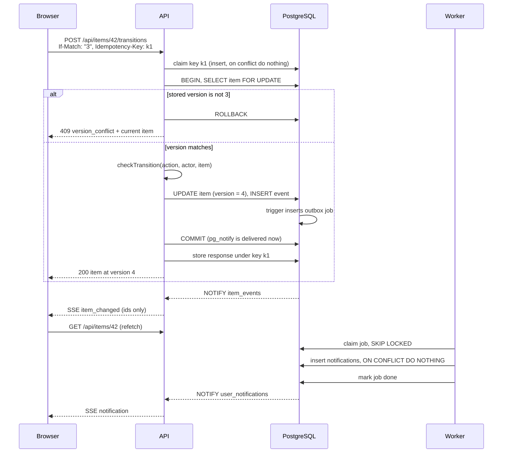
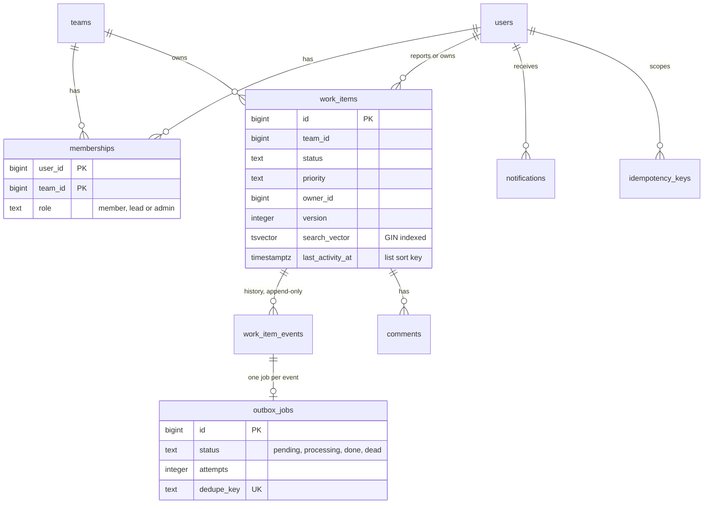

# Architecture

OpsDesk is three processes and one database.

Solid arrows are requests the process makes. Dotted arrows happen inside the database or are triggered by it.

## What happens on a change

## Data model

## Components

| Part | Where | Job |
|---|---|---|
| API | `server/src/app.ts`, `routes/`, `services/` | Authentication, authorization, validation, all state changes |
| Workflow rules | `server/src/domain/workflow.ts` | One table of allowed actions, who may do them and extra rules |
| List queries | `server/src/domain/itemQuery.ts` | Builds filtered, searched, keyset-paged queries |
| Worker | `server/src/worker.ts`, `jobs/`, `services/outbox.ts` | Turns events into notifications, retries, dead-letters, clean-up |
| Live stream | `server/src/services/realtime.ts`, `routes/stream.ts` | Forwards Postgres `NOTIFY` to connected browsers |
| Web app | `web/src/` | Dashboard, list, detail, optimistic updates, conflict banner |
| Migrations | `server/migrations/` | Schema, indexes, triggers; applied under an advisory lock |

## Why the shape looks like this

- All correctness lives in Postgres and the API transaction. The worker and the stream can fail, restart or run twice without breaking data.
- The browser never trusts a live ping as data: every ping is followed by a normal, authorized fetch.
- Adding a second API process needs no other change. Each one listens to Postgres itself, and idempotency keys, jobs and versions all live in the database.